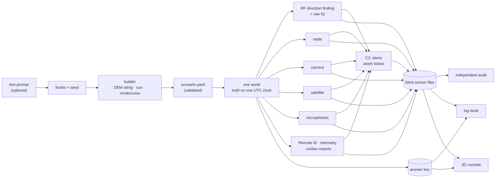

<div align="center">

# OASIS

**One world. Every signal.**

Synthetic aerial-defence scenarios over real Ukrainian terrain. OASIS simulates one true world, records what every sensor would physically have captured, and keeps an answer key for every record.

[**Live console**](https://oasis-chi-drab.vercel.app) · [The proof](#the-proof-oasis-vs-asking-an-llm) · [How it works](#how-it-works) · [Seed engine](#the-seed-engine) · [Log book](#the-log-book) · [Quickstart](#quickstart)

</div>


---

## Why this exists

Counter-drone AI is only as good as the data it learns from, and that data barely exists.

- **Real recordings are scarce, sensitive and unlabelled.** Nobody can tell you which radio burst came from which drone.
- **They never contain the edge cases that matter:** fibre-optic FPVs with no radio link, jamming, GNSS spoofing, decoys and terrain shadows.

OASIS **generates** that data, and proves it is physically consistent:

1. **One world, one clock.** Every drone, pilot, decoy, interceptor, bird and civilian is placed on real terrain and flown on one UTC clock. That is the ground truth.
2. **Sensors observe through physics.** Radio direction finding (the signal trace), raw IQ, radar, camera, satellite, microphones, Remote ID, our own drone's telemetry and civilian reports each see only what physics allows: terrain diffraction, line of sight, the sun, haze, the speed of sound and orbital geometry.
3. **Blind files plus an answer key.** Sensor files contain no truth. A separate answer key traces every record back to the object that caused it, and why: line of sight, diffraction loss, SNR, range.
4. **Independent audit.** A separate auditor checks the output with geometry, the DEM, causality and statistics. It never uses OASIS's own propagation models, so it cannot simply agree with itself.

## The proof: OASIS vs asking an LLM

The challenge asks why this beats asking a strong model for a dataset in one go. We tested exactly that.

**Setup.** One call to a strong general model, given the full scenario and asked for physically realistic sensor data in our file layout (`baselines/oneshot/`). Both datasets cover the same 10-minute window (14:07–14:17 UTC on the hero day) and go through the same 10 checks.

| Check | What it tests | **OASIS** | One-shot LLM |
|---|---|---|---|
| Provenance | every record traces to a real object; no truth leaks into sensor files | ✅ clean | ✅ clean |
| Clock sync | one UTC clock: `time_utc = start + t`, monotonic, inside the window | ✅ max error 0.5 ms | ❌ timestamps run backwards |
| Bearing geometry | line-of-sight bearings fall within 2σ of the true bearing | ✅ 95%, and it recovers the hidden mast offsets (+0.84° / −0.59°) | ❌ biased +28.6° / −48.7° |
| Occlusion gaps | receivers go quiet while terrain blocks the path | ✅ RF2 stays silent for all 336 s of the window in which a ridge hides the Mavic | ⚪ no drone ever goes behind terrain |
| Fix calibration | ~50% of position fixes fall inside their own reported CEP50 | ✅ 52.5% (236 fixes) | ❌ "too good": 8 m errors under a 50 m CEP |
| Range law | fitted path-loss exponent lies in the physical 1.5–4.5 band | ✅ 1.9 (RF1), 4.2 (RF2) | ⚪ too little data to test |
| Acoustic delay | sound arrives distance ÷ c(T) after emission | ✅ max error 0.17% | ⚪ no audio |
| Spoof visibility | spoofed GNSS shows up only inside the spoofing window | ✅ 2 m error outside vs 245 m inside | ⚪ no position reports |
| Cross-sensor time | every camera frame was cued by RF or radar within 5 s | ✅ 1,603 frames | ⚪ no frames |
| Terrain shadow | excess path loss is ≥ 10 dB higher behind terrain | ⚪ not enough mixed paths in this window | ⚪ |
| **Result** | | **9 pass · 0 fail · 1 skip** | **1 pass · 3 fail · 6 skip** |

**Volume.** Within that window, OASIS wrote **8,040 sensor records**, 2,716 of them radio bearings. The one-shot dataset holds **40** records in total.

**The deeper point.** An LLM can write plausible rows. It cannot keep 8,000 of them consistent with terrain, orbits, the speed of sound and each other. That consistency is what makes data trainable, and it is what the audit measures. Reproduce it with:

```sh
uv run python -m mirrorworld audit out/ros-valley --window 18720 19320 --baseline baselines/oneshot/out/ros-valley-oneshot
```

## The hero day

Area centre 49.3700° N · 31.2000° E (a 16 × 16 km valley), 4 Nov 2026, 08:55–14:35 UTC. The scenario is `scenarios/ros-valley.yaml`.

| UTC | What happens | What makes it hard |
|---|---|---|
| 09:06:39.787 | **Sentinel-2A passes overhead.** The pass is computed from orbit data. A Shahed is inserted into a real L2A scene at true size, with per-band timing smear and a sun-cast shadow | satellites see the past: each band is a different instant |
| 13:58:32 | **A hostile Mavic launches.** RF1 records it within a second. At 14:02:07 it is exactly at the challenge brief's example point | controller uplinks are DF'd at the operator: crossed bearings locate the **pilot** |
| 14:10:00 | **A fibre-optic FPV launches.** It has no radio link, so no electronic sensor records it. Three civilian reports, 179 s after launch, are its only trace | the threat that defeats RF-based defence, shown honestly |
| 14:11:23 | **The Mavic flies a leg through RF2's terrain shadow.** RF2 goes silent for 461 s while RF1 keeps bearing on it | dead zones come from the DEM, not from a script |
| 14:25–14:33 | **A 2.4 GHz barrage jammer runs (14:25:50–14:27:50), our own recon drone is GNSS-spoofed, and at 14:33:30 an FPV destroys the RF2 mast.** The jammer is airtime-weighted. The recon drone's telemetry drifts 245 m during the spoof | sensors fail as they would in reality |
| all day | **Protected power station SITE-01, a mobile air-defence team and C2-01.** C2 raises alerts from sensor data only. The answer key shows what really reached the site | the gap between what C2 knew and what happened |

<p align="center"></p>
<p align="center"><sub>The camera model draws a Blender-rendered airframe at its true angular size and viewing angle: 32 px across at 400 m, about 6 px at 2,140 m.</sub></p>

## How it works



**Rules the code enforces:**
- **One clock.** Every record carries `time_utc` and `t`, and the audit checks they agree to the millisecond.
- **Determinism.** Every random draw comes from a named stream (`ctx.rng(name)`), so the same scenario and seed always give the same files.
- **No leaks.** Sensor folders never contain truth columns, and the audit checks values as well as column names.
- **No silent skips.** A missing data source is logged, never quietly ignored. Every run must include the signal trace (an `rf_df` receiver).

## Sensors

One module each in `mirrorworld/sensors/`.

| Sensor | What it records |
|---|---|
| `rf_df` | Direction-finding receivers on real radio masts. Terrain diffraction is ITU-R P.526-16 delta-Bullington over the Copernicus 30 m DEM (validated against the reference implementation), with correlated shadowing, Rician fading, co-channel interference and barrage jamming. Bearing error grows with SNR and with terrain-blocked paths. **Controller uplinks are separate transmitters, so crossed bearings locate the pilot.** Outputs are CSV and TAK lines of bearing. |
| `rf_iq` | Raw 2.4 GHz IQ snapshots (SigMF) with every burst at its physical power. Per-burst labels are in the answer key. |
| `radar` | X-band plots with terrain masking, Swerling-1 fluctuation, birds-vs-drones confusion and clutter, plus an alpha-beta tracker with realistic gaps. |
| `camera` | Pan-tilt camera cued by RF fixes or radar tracks. The scene uses the real sun position, a horizon ray-marched from the DEM, and **3D drone models rendered in Blender** (`tools/render_sprites.py`), drawn at true pixel size and viewing angle, then hazed, blurred, noised and JPEG-compressed. Includes simulated detector output. |
| `satellite` | The real Sentinel-2 pass computed from orbit data, over a real Sentinel-2 L2A background. Movers are inserted at true size with per-band timing smear and a sun-cast shadow. |
| `microphone` | Per-microphone WAVs with speed-of-sound delay, Doppler, ISO 9613-1 absorption, terrain screening and wind, plus a CFAR tone detector. |
| `remote_id` | DroneID-style broadcasts that leak the pilot's position and carry the drone's *believed* (spoofable) GNSS. |
| `telemetry` | Our own drone's log, which drifts under GNSS spoofing. |
| `reports` | Civilian (ePPO-style) and observer reports in Ukrainian and English, generated only when that person could physically see or hear the object. In the hero day they are the only trace of the fibre-optic FPV. |
| `c2` | Command-post alerts (new track, approaching site, lost contact, sensor silent), response-asset status and protected-site status, all derived from sensor data only. |

**Fused output.** Crossed bearings become position fixes with honest error ellipses (`fused/fixes.csv`). These are exported as TAK Cursor-on-Target alongside the lines of bearing and sensor positions, ready for ATAK.

## The seed engine

Knobs plus a seed give a validated scenario. Everything geometric is computed from the real DEM and the sun, never guessed.

**The built world is fixed per sector.** The protected site, the air-defence positions, the receiver masts (sited on the DEM for coverage) with their calibration offsets, and the microphones all come from the sector alone. They are identical for every seed, and `tests/test_builder.py` checks it.

**The seed drives only what moves:** drone types, entry sides, corridors, altitudes, timing, interceptor rendezvous, birds, the jammer window and the weather.

| Template | What happens | Audit (seed 1, area centre 49.3754° N · 31.1882° E) |
|---|---|---|
| `incoming` | mixed hostiles converge on the protected site from random sides | 7 pass · 0 fail |
| `intercepted` | interceptors launch from the AD team to **exact** rendezvous points on one-way drones | 7 pass · 1 fail |
| `lost-contact` | a Mavic leg is hidden in a receiver's terrain shadow, a fibre-optic FPV comes in, and a jammer runs | 6 pass · 2 fail |
| `saturation` | one-way drones arrive in 2–3 tight waves from one side, more than the defence can service | 6 pass · 2 fail |
| `recon-strike` | a recon UAV orbits the AD battery and a loitering munition follows it in mid-orbit | 7 pass · 0 fail |

Failures are listed under [Known limits](#known-limits); we show them rather than tune them away.

```sh
uv run python -m mirrorworld.builder --template saturation --seeds 1-4 --run      # build, simulate and audit 4 raids
uv run python -m mirrorworld.builder --sector random --template intercepted --drones 12 --seed 4 --run
uv run python generate_scenario.py --matrix --seed 1                              # every asset-catalog preset × sector
uv run python -m mirrorworld prompt "two Mavics scouting a dam at dusk, a fibre-optic FPV up the river" -o scenarios/new.yaml --run
```

Other knobs: `--drones`, `--mix shahed136:3,gerbera:2,orlan10:1`, `--entry N|E|S|W`, `--spread`, `--tod dusk|dawn|morning|noon|night|HH:MM`, `--date`, `--duration`, `--preset minimal|standard|full`, `--defence`, `--birds`, `--wifi`.

**Airframes** are public-source archetypes from `mirrorworld/catalog.py` and `data/assets.json`:
- **Hostile:** Geran-2/Shahed, Gerbera decoy, Orlan-10, ZALA, Supercam, Lancet-type loitering munition, Mavic, analog and fibre-optic FPV.
- **Friendly:** interceptor drones (Octopus, JEDI classes), ground air-defence teams and AD batteries.
- **Sites:** fictional protected sites (power station, water works, hospital).

## The log book

Every run gets `out/<name>/logbook.md`: one time-ordered account that labels each line with the voice it comes from.
- **TRUTH** is what happened.
- **SENSOR** is the first time each sensor recorded each object.
- **C2** is what the command post concluded from sensor data alone.

It ends with this table, taken unedited from the hero day:

| hostile | airborne | first sensor record | first C2 alert | truth outcome |
|---|---|---|---|---|
| shahed_am | 09:03:01 | 09:03:16 (+15 s) | none | approached |
| mavic_1 | 13:58:32 | 13:58:33 (+0 s) | 14:01:01 (+148 s) | reached |
| fpv_fiber_1 | 14:10:00 | 14:12:58 (+179 s) | none | not reached |
| shahed_1 | 14:23:20 | 14:23:26 (+6 s) | none | not reached |
| fpv_1 | 14:24:55 | 14:24:55 (+0 s) | 14:26:12 (+77 s) | not reached |

The Mavic that reached the protected site was in the RF data within a second, yet C2 only alerted 148 s later. That kind of finding is what a training set should expose.

```sh
uv run python -m mirrorworld.logbook out/ros-valley
uv run python scripts/publish_runs.py dist          # every run: its own console, log book and raw files, one index
```

## The console

- **Modes:**
  - **Operator** shows sensor data only.
  - **God mode** shows the truth.
  - **Delta** shows both, with a line from each observation to the truth.
- **Map:** the replay runs on the simulation's own DEM with a baked Sentinel-2 + hillshade texture. The full landscape stays around the sector as context, and every location is shown as coordinates.
- **Panels:** an observation deck (camera frames, IQ spectrograms, satellite chips, audio, the audit and an inspector), a signal ledger, and a timeline with key moments.
- **Markers:** asset-catalog icons for sites, teams, drones and sensor masts. They scale with zoom, and detail lines appear only close in.

```sh
npm install && npm run data:export && npm run dev        # Vite + CesiumJS, reads dashboard/public/data.js
npm run build                                            # static dist/, deployable anywhere
uv run python -m mirrorworld dash out/ros-valley --serve # dependency-free fallback replay at localhost:8765
```

## Quickstart

```sh
uv sync
uv run python -m mirrorworld run scenarios/ros-valley.yaml --skip-missing   # hero day → out/ros-valley/
uv run python -m mirrorworld audit out/ros-valley                           # physics checks → audit.md / audit.json
uv run python -m mirrorworld.logbook out/ros-valley                         # the readable story → logbook.md
```

- **Prompt mode** needs `OPENAI_API_KEY` in `.env`. The LLM only fills scenario intent; coordinates, sensor sites, flight paths and times of day are computed from terrain and the sun.
- **First run** downloads the DEM tiles and Sentinel-2 scenes it needs into `cache/`.
- **Self-checks:** every module has one, e.g. `uv run python tests/test_builder.py`.

## What a run produces (`out/<name>/`)

| Path | What |
|---|---|
| `scenario.yaml`, `run.json` | the exact input, and the manifest: data sources, DEM tiles, skipped sensor types |
| `truth/tracks.csv`, `truth/objects.csv` | every object's position and velocity on one UTC clock, plus what its own GNSS *believed* (spoofing lives here) |
| `sensors/<id>/` | only what that sensor recorded, with no truth columns: CSV, JSONL, TAK XML, JPEG, WAV, SigMF |
| `answer_key/<id>.csv` | for each record, the object that produced it, its role, and the physics behind it (line of sight, diffraction loss, SNR, range, delay, pixels on target) |
| `fused/fixes.csv`, `fixes.cot.xml` | crossed-bearing positions computed from sensor data alone, as TAK Cursor-on-Target |
| `audit.json`, `audit.md` | the independent checks |
| `logbook.md` | the time-ordered story: truth, sensors and C2 |

## Known limits

We list these because a dataset you can't trust is worse than none.

- **Range-law check on generated runs.** It fails on three of the five template runs: fitted exponents range from 0.26 to 8.8, against 1.9 and 4.2 on the hero. The suspect is geometry, since DEM-sited masts on high ground see mostly diffraction-free paths over a narrow range spread. It needs a closer look before we trust that statistic on builder scenarios.
- **Terrain-shadow contrast.** One generated receiver shows 9.2 dB against a 10 dB threshold.
- **Wind in the acoustic audit.** The audit models air temperature but not wind, so one windy run exceeds the 2% tolerance (2.35%).
- **Airframes are archetypes.** Platform numbers (speeds, RCS, sound levels, link bands) come from public sources (`docs/research/`); they are not performance data. Camera models are procedural airframes rendered in Blender, not exact replicas.
- **Fictional sites.** Protected sites and their names are fictional. Radio masts are real (OpenStreetMap), and everything about the drones is synthetic.

## Repository

```
mirrorworld/        engine: config, world (DEM), truth, sensors/, builder (seed engine), audit, log book, exporter, prompt
scenarios/          hero + generated scenarios          tests/       one self-check per module
data/               asset catalog and presets            baselines/   the one-shot LLM dataset and its prompt
dashboard/          Vite + CesiumJS console              docs/        research notes, brief, media
tools/              Blender sprite renderer              scripts/     runs page, status board
```

## Data sources and attribution

- **Terrain:** Copernicus DEM GLO-30, © DLR e.V. 2010–2014 and © Airbus Defence and Space GmbH 2014–2018, provided under COPERNICUS by the European Union and ESA.
- **Imagery:** contains modified Copernicus Sentinel data (Sentinel-2 L2A via the Earth Search STAC catalogue).
- **Radio-mast locations:** © OpenStreetMap contributors (ODbL).
- **Orbits:** CelesTrak. **Ephemeris:** JPL DE421.
- **Console basemap outside the scenario area:** Esri, Maxar, Earthstar Geographics.
- **Icons:** Tabler Icons (MIT).
- **Propagation:** ITU-R P.526-16 diffraction, validated against the reference implementation to 1e-14 dB.
