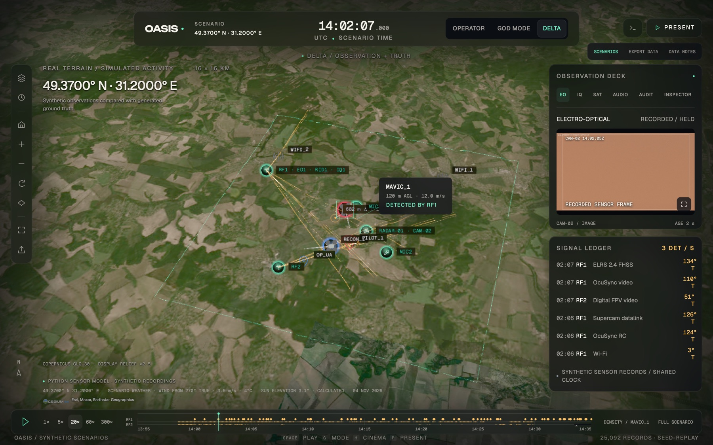
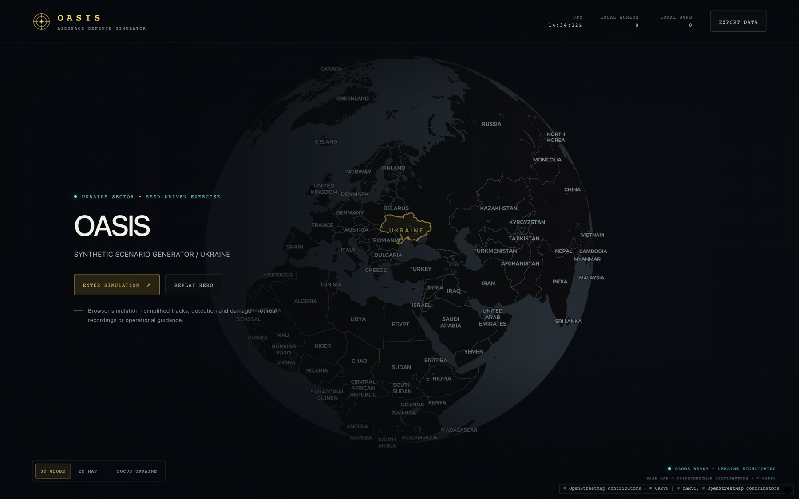
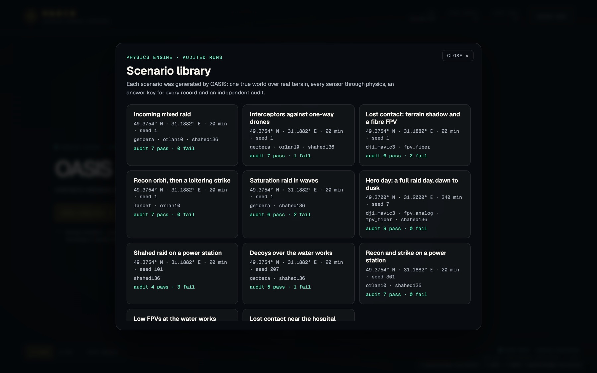
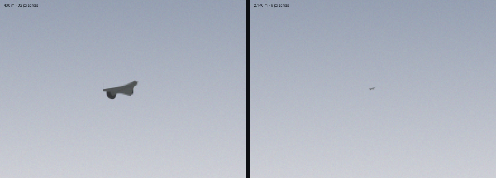
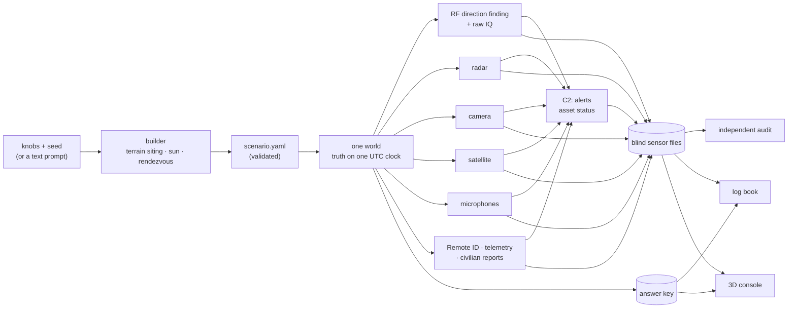

<div align="center">

# OASIS

**One world. Every signal.**

Synthetic aerial-defence data over real Ukrainian terrain: the truth, what every sensor would physically have recorded, and an answer key for every record.

[**Open the live console →**](https://oasis-chi-drab.vercel.app)

[The proof](#the-proof-oasis-vs-asking-an-llm) · [Try it](#try-it) · [How it works](#how-it-works) · [Sensors](#sensors) · [Seed engine](#the-seed-engine) · [Showcase stories](#showcase-stories) · [Quickstart](#quickstart)

</div>



| What you get | |
|---|---|
| **The truth** | Every drone, pilot, decoy, interceptor and flock on one UTC clock over the Copernicus 30 m terrain model. |
| **Every sensor** | Ten sensors, led by radio direction finding (the signal trace), each recording only what physics allows. |
| **An answer key** | Every record traced to the object that caused it, and why: line of sight, diffraction loss, SNR, range, delay. |
| **An independent audit** | Ten checks from geometry, terrain, causality and statistics that never use OASIS's own models. |

**The proof in one line:** on the same 10-minute window, OASIS passes **9 of 9** applicable checks with **8,040** records; a one-shot LLM dataset passes **1** and fails **3**, with **40** records.

---

## Why this exists

Counter-drone AI is only as good as its training data, and that data barely exists.

- **Real recordings are scarce, sensitive and unlabelled.** Nobody can say which radio burst came from which drone, or where its pilot stood.
- **They never contain the cases that matter most:** fibre-optic FPVs with no radio link, jamming, GNSS spoofing, decoys, terrain shadows.

OASIS generates that data and proves it is physically consistent, so a model trained on it learns physics, not artefacts.

## The proof: OASIS vs asking an LLM

The challenge asks why this beats asking a strong model for a dataset in one go. We ran exactly that test. One call to a strong general model, given the full scenario and asked for physically realistic sensor data in our file layout (`baselines/oneshot/`). Both datasets cover the same window (14:07–14:17 UTC on the hero day) and face the same ten checks.

| Check | What it tests | **OASIS** | One-shot LLM |
|---|---|---|---|
| Provenance | every record traces to a real object; no truth leaks into sensor files, as columns or as values | ✅ clean | ✅ clean |
| Clock sync | one UTC clock: `time_utc = start + t`, monotonic, inside the window | ✅ max error 0.5 ms | ❌ timestamps run backwards |
| Bearing geometry | line-of-sight bearings fall within 2σ of the true bearing | ✅ 95%, and it recovers the hidden mast offsets (+0.84° / −0.59°) | ❌ biased +28.6° / −48.7° |
| Occlusion gaps | receivers go quiet while terrain blocks the path | ✅ RF2 silent for all 336 s of the window in which a ridge hides the Mavic | ⚪ no drone ever goes behind terrain |
| Fix calibration | about half of the position fixes fall inside their own reported CEP50 | ✅ 52.5% of 236 fixes | ❌ "too good": 8 m errors under a 50 m CEP |
| Range law | fitted path-loss exponent lies in the physical 1.5–4.5 band | ✅ 1.9 (RF1), 4.2 (RF2) | ⚪ too little data to test |
| Acoustic delay | sound arrives distance ÷ c(T) after emission, c from the air temperature | ✅ max error 0.17% | ⚪ no audio |
| Spoof visibility | spoofed GNSS shows up only inside the spoofing window | ✅ 2 m median error outside, 245 m inside | ⚪ no position reports |
| Cross-sensor time | every camera frame was cued by RF or radar within 5 s | ✅ 1,603 frames | ⚪ no frames |
| Terrain shadow | excess path loss is ≥ 10 dB higher behind terrain | ⚪ not enough mixed paths in this window | ⚪ |
| **Result** | | **9 pass · 0 fail · 1 skip** | **1 pass · 3 fail · 6 skip** |

In that window OASIS wrote **8,040 sensor records**, 2,716 of them radio bearings. The one-shot dataset holds **40**. An LLM can write plausible rows; it cannot keep 8,000 of them consistent with terrain, orbits, the speed of sound and each other. That consistency is what makes data trainable, and it is what the audit measures.

```sh
uv run python -m mirrorworld audit out/ros-valley --window 18720 19320 --baseline baselines/oneshot/out/ros-valley-oneshot
```

## Try it

**Live console:** <https://oasis-chi-drab.vercel.app>

1. The entry globe opens with Ukraine highlighted.
2. **Enter simulation** opens the scenario library: eleven runs, each generated by the physics engine and audited.
3. Pick one. It loads into the 3D console, where **Operator** shows only what the sensors saw, **God mode** shows the truth, and **Delta** shows both, with a line from each observation to the truth.

<p align="center">
  
  
</p>

**Things to look for in the hero day:**
- At **14:02:07 UTC** the Mavic is exactly at the challenge brief's example point.
- At **14:10** the fibre-optic FPV launches; no electronic sensor records it.
- At **14:11:23** a ridge silences RF2 while RF1 keeps bearing.

The public site carries every third camera frame and no WAV audio, to stay light. A local run has everything.

## The hero day

Area centre 49.3700° N · 31.2000° E, a 16 × 16 km valley, 4 Nov 2026, 08:55–14:35 UTC (`scenarios/ros-valley.yaml`). It runs from a morning satellite pass to dusk.

| UTC | What happens | Why it is hard |
|---|---|---|
| 09:06:39.787 | **Sentinel-2A passes overhead.** The pass is computed from orbit data. A Shahed is inserted into a real L2A scene at true size, with per-band timing smear and a sun-cast shadow | each band is a different instant |
| 13:58:32 | **A hostile Mavic launches.** RF1 records it within a second; at 14:02:07 it sits on the brief's example point | controller uplinks are found at the operator: crossed bearings locate the **pilot** |
| 14:10:00 | **A fibre-optic FPV launches.** It has no radio link, so no electronic sensor records it. Three civilian reports, 179 s after launch, are its only trace | the threat that defeats RF-based defence, shown honestly |
| 14:11:23 | **The Mavic flies through RF2's terrain shadow.** RF2 goes silent for 461 s while RF1 keeps bearing | dead zones come from the DEM, not from a script |
| 14:25–14:33 | **A 2.4 GHz barrage jammer runs (14:25:50–14:27:50), our recon drone is GNSS-spoofed, and at 14:33:30 an FPV destroys the RF2 mast** | sensors fail as they would in reality |
| all day | **A protected power station, a mobile air-defence team and a command post (C2).** C2 raises alerts from sensor data only; the answer key shows what really reached the site | the gap between what C2 knew and what happened |

<p align="center"></p>
<p align="center"><sub>The camera draws a Blender-rendered airframe at its true angular size and viewing angle: 32 px across at 400 m, about 6 px at 2,140 m.</sub></p>

## How it works



**Rules the code enforces**
- **One clock.** Every record carries `time_utc` and `t`; the audit checks they agree to the millisecond.
- **Determinism.** Every random draw comes from a named stream (`ctx.rng(name)`), so the same scenario and seed always give the same files.
- **No leaks.** Sensor folders never contain truth, and the audit checks values as well as column names.
- **The signal trace is mandatory.** A scenario without a radio direction-finding receiver is refused.

## Sensors

One module each in `mirrorworld/sensors/`, all on the same clock.

| Sensor | What it records |
|---|---|
| `rf_df` | **The signal trace.** Direction-finding receivers on real radio masts. Terrain diffraction is ITU-R P.526-16 delta-Bullington over the 30 m DEM, matching the reference implementation to about 1e-14 dB, with correlated shadowing, Rician fading, co-channel interference and barrage jamming. Bearing error grows with SNR and with terrain-blocked paths. Controller uplinks are separate transmitters, so crossed bearings locate the pilot. Outputs CSV and TAK lines of bearing. |
| `rf_iq` | Raw 2.4 GHz IQ snapshots (SigMF), every burst at its physical power; per-burst labels in the answer key. |
| `radar` | X-band plots with terrain masking, Swerling-1 fluctuation, birds-vs-drones confusion and clutter, plus an alpha-beta tracker with realistic gaps. |
| `camera` | Pan-tilt camera cued by RF fixes or radar tracks. Real sun position, a horizon ray-marched from the DEM, and Blender-rendered airframes (`tools/render_sprites.py`) at true pixel size and viewing angle, then hazed, blurred, noised and JPEG-compressed. Includes detector output. |
| `satellite` | The real Sentinel-2 pass from orbit data, over a real Sentinel-2 L2A background; movers inserted at true size with per-band timing smear and a sun-cast shadow. |
| `microphone` | Per-microphone WAVs with speed-of-sound delay, Doppler, ISO 9613-1 absorption, terrain screening and wind, plus a CFAR tone detector. |
| `remote_id` | DroneID-style broadcasts that leak the pilot's position and carry the drone's *believed* (spoofable) GNSS. |
| `telemetry` | Our own drone's log, which drifts under GNSS spoofing. |
| `reports` | Civilian (ePPO-style) and observer reports in Ukrainian and English, generated only when that person could physically see or hear the object. |
| `c2` | Command-post alerts (new track, approaching site, lost contact, sensor silent), response-asset status and protected-site status, from sensor data only. |

**Fused output.** Crossed bearings become position fixes with honest error ellipses (`fused/fixes.csv`), exported as TAK Cursor-on-Target next to the lines of bearing, ready for ATAK.

## The seed engine

Knobs plus a seed give a validated scenario. Everything geometric comes from the real DEM and the sun.

- **The built world is fixed per sector.** The protected site, the air-defence positions, the receiver masts (sited on the terrain for coverage) with their calibration offsets, and the microphones depend on the sector alone, never on the seed. `tests/test_builder.py` checks it.
- **The seed changes only what moves:** drone types, entry sides, corridors, altitudes, timing, interceptor rendezvous, birds, the jammer window and the weather.

| Template | What happens | Audit (seed 1, 49.3754° N · 31.1882° E) |
|---|---|---|
| `incoming` | mixed hostiles converge on the protected site from random sides | 7 pass · 0 fail |
| `intercepted` | interceptors launch from the air-defence team to exact rendezvous points on one-way drones | 7 pass · 1 fail |
| `lost-contact` | a Mavic leg hidden in a receiver's terrain shadow, a fibre-optic FPV, a jammer | 6 pass · 2 fail |
| `saturation` | one-way drones in 2–3 tight waves from one side, more than the defence can service | 6 pass · 2 fail |
| `recon-strike` | a recon UAV orbits the air-defence battery; a loitering munition follows it in | 7 pass · 0 fail |

```sh
uv run python -m mirrorworld.builder --template saturation --seeds 1-4 --run     # build, simulate and audit four raids
uv run python -m mirrorworld.builder --sector random --template intercepted --drones 12 --seed 4 --run
uv run python generate_scenario.py --matrix --seed 1                             # every asset-catalog preset × sector
uv run python -m mirrorworld prompt "two Mavics scouting a dam at dusk, a fibre-optic FPV up the river" -o scenarios/new.yaml --run
```

More knobs: `--drones`, `--mix shahed136:3,gerbera:2,orlan10:1`, `--entry N|E|S|W`, `--spread`, `--tod dusk|dawn|morning|noon|night|HH:MM`, `--date`, `--duration`, `--preset minimal|standard|full`, `--defence`, `--birds`, `--wifi`. Prompt mode only fills scenario intent; positions, paths and times are still computed from terrain and the sun.

**Airframes** are public-source archetypes (`mirrorworld/catalog.py`, `data/assets.json`):
- **Hostile:** Geran-2/Shahed, Gerbera decoy, Orlan-10, ZALA, Supercam, Lancet-type loitering munition, Mavic, analog and fibre-optic FPV.
- **Friendly:** interceptor drones (Octopus and JEDI classes), ground air-defence teams and batteries.
- **Sites:** fictional power station, water works and hospital.

## Showcase stories

Five fixed scenarios with a planned outcome each (`scenarios/showcase/`), all at 49.3754° N · 31.1882° E for 20 minutes from 14:01 UTC. `run_showcase.py` simulates each one, counts hostiles, interceptions and site reaches from the truth, and stops if they differ from the plan. All five reproduce their plan.

| Story | Aircraft | Response | Planned and reproduced | Audit |
|---|---|---|---|---|
| Shahed raid on a power station | 3 Shahed-type | JEDI-class interceptor | 1 intercepted, 2 reach the site | 4 pass · 3 fail |
| Decoys over the water works | 2 Shahed-type, 2 Gerbera decoys | 2 Octopus-class | 2 intercepted, 2 reach the site | 5 pass · 1 fail |
| Recon and strike on a power station | 2 Shahed-type, 2 Orlan-10 | interceptor | 1 intercepted, 1 reaches; both recon aircraft turn away | 7 pass · 0 fail |
| Low FPVs at the water works | 2 analog FPV, 2 fibre FPV | 2 JEDI-class | 2 intercepted, 2 reach the site | 7 pass · 1 fail |
| Lost contact near the hospital | Mavic recon, fibre FPV | JEDI-class, misses | neither reaches; the fibre FPV stops 836 m short | 7 pass · 0 fail |

```sh
uv run python run_showcase.py all              # simulate, check the planned outcomes, audit, export replays
uv run python run_showcase.py 03-recon-power --serve
```

## The log book

Every run gets `out/<name>/logbook.md`, one time-ordered account in three voices:
- **TRUTH** is what happened.
- **SENSOR** is the first time each sensor recorded each object.
- **C2** is what the command post concluded from sensor data alone.

It ends with the outcome per hostile. Unedited, from the hero day:

| hostile | airborne | first sensor record | first C2 alert | truth outcome |
|---|---|---|---|---|
| shahed_am | 09:03:01 | 09:03:16 (+15 s) | none | approached |
| mavic_1 | 13:58:32 | 13:58:33 (+0 s) | 14:01:01 (+148 s) | reached |
| fpv_fiber_1 | 14:10:00 | 14:12:58 (+179 s) | none | not reached |
| shahed_1 | 14:23:20 | 14:23:26 (+6 s) | none | not reached |
| fpv_1 | 14:24:55 | 14:24:55 (+0 s) | 14:26:12 (+77 s) | not reached |

The Mavic that reached the protected site was in the radio data within a second, yet C2 alerted only 148 s later. A training set should expose exactly that kind of gap.

## The console

- **Entry and library.** A globe with Ukraine highlighted, then the scenario library built from `runs/index.json`. `scripts/publish_runs.py` writes that index and gives every run its data, log book and raw files.
- **Map.** The replay runs on the simulation's own DEM with a baked Sentinel-2 + hillshade texture; the landscape around the sector stays visible as darker context. Every location is shown as coordinates.
- **Markers.** Sites, teams and sensor masts are glass badges coloured by side and status. Drones are drawn as their Blender-rendered airframes (quad, delta wing, fixed wing), turned to their heading. Markers grow as you zoom in; detail lines appear only up close.
- **Readable on any terrain.** The imagery is graded down, every map label sits on a dark backing, and overlay text carries a halo.
- **Panels.** An observation deck (camera frames, IQ spectrograms, satellite chips, audio, the audit, an inspector), a signal ledger and a timeline with key moments.

```sh
npm install && npm run data:export && npm run dev       # Vite + CesiumJS dev server, reads dashboard/public/data.js
npm run build                                           # static dist/, deployable anywhere
uv run python scripts/publish_runs.py dist              # add every audited run in out/ to the build's scenario library
uv run python -m mirrorworld dash out/ros-valley --serve # dependency-free fallback replay at localhost:8765
```

## Quickstart

```sh
uv sync
uv run python -m mirrorworld run scenarios/ros-valley.yaml --skip-missing   # hero day → out/ros-valley/
uv run python -m mirrorworld audit out/ros-valley                           # physics checks → audit.md, audit.json
uv run python -m mirrorworld.logbook out/ros-valley                         # the story → logbook.md
```

- **First run** downloads the DEM tiles and Sentinel-2 scenes it needs into `cache/`.
- **Prompt mode** needs an LLM API key in `.env` (the variable name is in `mirrorworld/prompt.py`).
- **Self-checks:** one per module, e.g. `uv run python tests/test_builder.py`.

## What a run produces (`out/<name>/`)

| Path | What |
|---|---|
| `scenario.yaml`, `run.json` | the exact input, and the manifest: data sources, DEM tiles, skipped sensor types |
| `truth/tracks.csv`, `truth/objects.csv` | every object's position and velocity on one UTC clock, plus what its own GNSS *believed* (spoofing lives here) |
| `sensors/<id>/` | only what that sensor recorded, with no truth: CSV, JSONL, TAK XML, JPEG, WAV, SigMF |
| `answer_key/<id>.csv` | for each record, the object that produced it, its role and the physics behind it |
| `fused/fixes.csv`, `fixes.cot.xml` | crossed-bearing positions from sensor data alone, also as TAK Cursor-on-Target |
| `audit.json`, `audit.md` | the independent checks |
| `logbook.md` | the time-ordered story: truth, sensors and C2 |

## Known limits

A dataset you can't trust is worse than none, so the failures are listed rather than tuned away.

- **Range law on generated runs.** The fitted path-loss exponent leaves the 1.5–4.5 band for at least one receiver in three template runs and two showcase stories (from −0.41 to 8.8; the hero gives 1.9 and 4.2). Receivers sited on high ground see few blocked paths over a narrow spread of ranges, which makes that fit fragile. It needs work before we trust the statistic there.
- **Terrain-shadow contrast.** Two runs show 9.2 dB and 9.6 dB against a 10 dB threshold.
- **Fix calibration on short stories.** Two showcase stories produce only 10 and 3 position fixes, too few for a calibration test to mean much.
- **Wind in the acoustic audit.** The audit models air temperature but not wind, so the windiest run exceeds the 2% tolerance (2.35%).
- **Archetypes, not performance data.** Speeds, RCS, sound levels and link bands come from public sources (`docs/research/`). Camera models are procedural airframes rendered in Blender, not exact replicas.
- **Fictional sites.** Protected sites are fictional. Radio-mast positions are real (OpenStreetMap); everything about the drones is synthetic.

## Repository

```
mirrorworld/        engine: config, world (DEM), truth, sensors/, builder (seed engine), audit, log book, exporter, prompt
scenarios/          hero, generated scenarios and showcase/ stories      tests/       one self-check per module
data/               asset catalog and presets                            baselines/   the one-shot LLM dataset and its prompt
dashboard/          Vite + CesiumJS console                              docs/        research notes, brief, media
tools/              Blender sprite renderer                              scripts/     runs page and library, status board
run_showcase.py     showcase runner with outcome checks                  generate_scenario.py   asset-catalog presets
```

## Data sources and attribution

- **Terrain:** Copernicus DEM GLO-30, © DLR e.V. 2010–2014 and © Airbus Defence and Space GmbH 2014–2018, provided under COPERNICUS by the European Union and ESA.
- **Imagery:** contains modified Copernicus Sentinel data (Sentinel-2 L2A via the Earth Search STAC catalogue).
- **Radio-mast locations and entry-map base layer:** © OpenStreetMap contributors (ODbL); © CARTO.
- **Orbits:** CelesTrak. **Ephemeris:** JPL DE421.
- **Console basemap outside the scenario area:** Esri, Maxar, Earthstar Geographics.
- **Icons:** Tabler Icons (MIT).
